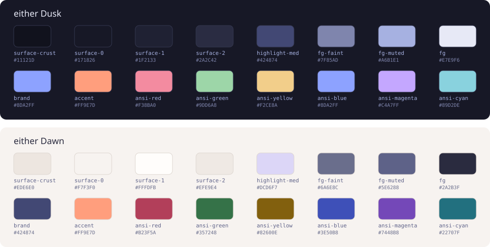
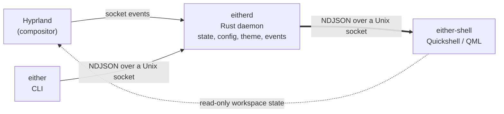

<h1 align="center">
  <picture>
    <source media="(prefers-color-scheme: dark)" srcset="docs/assets/banner-dark.svg">
    <source media="(prefers-color-scheme: light)" srcset="docs/assets/banner-light.svg">
    
  </picture>
</h1>

<p align="center">
  <b>A calm Hyprland desktop for Arch Linux, built as one system.</b><br>
  A native Quickshell shell, a Rust daemon and CLI that own all state, and one set of design tokens<br>
  that colours the shell, Hyprland, the terminal, and GTK and Qt applications, in a dark and a light theme.
</p>

<p align="center">
  <a href="#status">Status</a> ·
  <a href="#one-palette-two-states">Design</a> ·
  <a href="#what-is-being-built">What is being built</a> ·
  <a href="#how-it-fits-together">Architecture</a> ·
  <a href="#what-is-checked">What is checked</a> ·
  <a href="docs/roadmap.md">Roadmap</a> ·
  <a href="CONTRIBUTING.md">Contributing</a>
</p>

either is a restart: a Hyprland desktop designed as one system instead of a collection of configs. The goals are a stable foundation, native performance, a calm and consistent design, and a stack that is entirely free and open source. Hyprland stays the base. either builds on it and does not fork it.

## Status

either is in its **foundation phase**, before release 0.1.0. The repository holds the project structure, the quality gates, the design system with its brand assets, and the architecture decisions. **There is nothing to install yet.** Release 0.1.0 is a thin walking skeleton that connects every layer from Hyprland to a bar on screen; the [roadmap](docs/roadmap.md) lists what each release delivers and how it is judged done.

## One palette, two states

<picture>
  
</picture>

**either Dusk** (dark) and **either Dawn** (light) share one geometry and one motion language. Only the colours change. Every colour, size, radius and duration comes from a single [token file](design/tokens/tokens.json), and the shell, Hyprland, the terminal and the GTK and Qt applications are meant to be generated from it, so they cannot drift apart. The rules, from typography to motion, are in the [design system](docs/development/design-system.md).

## What is being built

The scope of 1.0 is fixed by the roadmap.

- **A shell.** A bar with an island in the middle that grows into the launcher, media controls, and volume and brightness feedback. Panels drop from the bar, and only one is open at a time.
- **Everyday desktop tools.** Launcher, notifications and a notification center, control center for network, Bluetooth, audio and power, clipboard history and emoji, screenshots and screen recording, power and either menus.
- **A complete session.** Lock screen, idle handling, a login screen, power profiles, wallpaper, and a first-run wizard.
- **Settings.** One application for appearance, displays, input, power, and the rest, with search.
- **Distribution.** A signed pacman repository, an `either setup` command for an existing Arch system, and an ISO.
- **Tiling that stays out of the way.** Dwindle by default, master and scrolling per workspace, and dialogs that float automatically.

The full list, with the release that delivers each part, is in the [roadmap](docs/roadmap.md).

## How it fits together



| Layer | Component | Language |
| --- | --- | --- |
| Kernel and system | Linux, systemd, Btrfs with snapper | upstream |
| Session and display | Hyprland, xdg-desktop-portal-hyprland, PipeWire, uwsm | upstream |
| Core daemon | `eitherd`, the single owner of state | Rust |
| Shell | `either-shell` on Quickshell, C++ plugins for heavy paths | QML, C++ |

`eitherd` owns all state and talks to every client through one versioned IPC contract. Every component runs as a systemd user unit, so a crashed shell restarts and fetches its state again without losing anything. The details, including the IPC contract, the configuration layers and the security model, are in [docs/architecture.md](docs/architecture.md).

## Install

There is nothing to install yet. Distribution starts at 0.6.0 with a pacman repository and an `either setup` command, and the ISO follows at 0.7.0. Until then you can set up a development environment: see [docs/development/setup.md](docs/development/setup.md).

## What is checked

either is developed on Arch Linux with Hyprland. No runtime code exists yet, so today only the repository itself is checked.

| | |
| --- | --- |
| Checked on every change | Rust formatting and Clippy with warnings as errors, ShellCheck, `qmllint`, dependency advisories and licenses with `cargo-deny`, relative links in the documentation, that every tracked text file is in English, the structure and WCAG contrast of the design tokens and the files in `design/assets`, that QML uses no literal colours or sizes, that every source file carries an SPDX license header, and that the tree only holds components from the 1.0 inventory. They run through git hooks and `just check`, and CI runs `just check` on every pull request and every push to `main`. |
| Checked by hand | Nothing yet. Runtime behaviour such as the bar, the Hyprland bridge and the package install is verified on a real Arch session as each release lands. |
| Not tested | Everything that needs a running session: Hyprland and Quickshell integration (to be verified in 0.1.0), NVIDIA graphics, several monitors, fractional scaling, other distributions. |

If something breaks on your machine once releases exist, an [issue](https://github.com/sya17/either/issues/new/choose) with the output of `hyprctl version` helps a lot.

## Contributing

Contributions are welcome, within the scope of the current release. Read [CONTRIBUTING.md](CONTRIBUTING.md) first.

```bash
git clone https://github.com/sya17/either.git && cd either
just setup    # install the git hooks
just check    # run every gate
```

## Keep reading

- [Architecture](docs/architecture.md): layers, processes, configuration, the IPC contract, and the security model.
- [Roadmap](docs/roadmap.md): releases 0.1.0 to 1.0.0, their scope and exit criteria.
- [Development setup](docs/development/setup.md), [workflow](docs/development/workflow.md), [coding standards](docs/development/coding-standards.md), and [quality gates](docs/development/quality.md).
- [Design system](docs/development/design-system.md): identity, tokens, typography, motion and components.
- [Decision records](docs/adr/README.md): why the project is built this way, and which decisions are still open.
- [Changelog](CHANGELOG.md) and [security policy](SECURITY.md).

## License

Code is licensed under [GPL-3.0-or-later](LICENSE). The brand assets in `design/assets` are licensed under CC BY-SA 4.0, see [design/assets/LICENSES.md](design/assets/LICENSES.md). Hyprland, Quickshell, Qt, and the fonts and applications either themes belong to their authors.
